# Memoria: Docker Avanzado (Dockerfile, Volúmenes, Redes y Compose)
## Dani Perez
### ASIR 2

---

## Ejercicio 1: Redes personalizadas y resolución DNS

Se crea una red personalizada de tipo `bridge` llamada `red_practica` y se lanza en ella un contenedor de Redis con el nombre `mi_cache`.

```bash
sudo docker network create --driver bridge red_practica
sudo docker network ls
sudo docker run -d --name mi_cache --network red_practica redis:alpine
```

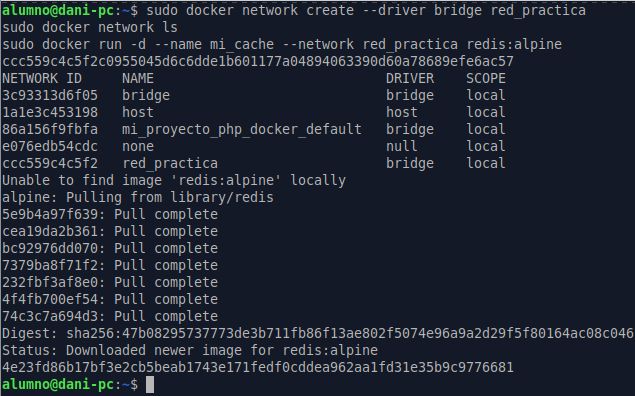

A continuación, desde un contenedor temporal de Alpine conectado a la misma red, se hace ping usando directamente el nombre del contenedor:

```bash
sudo docker run --rm -it --network red_practica alpine ping mi_cache
```

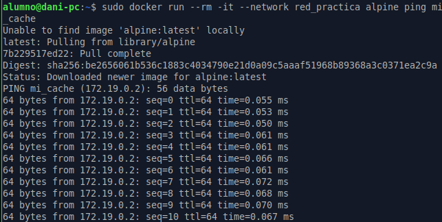

El ping resuelve el nombre `mi_cache` a su dirección IP, lo que demuestra que el DNS interno de Docker traduce los nombres de los contenedores en las redes personalizadas.

---

## Ejercicio 2: Persistencia de datos

### Bind mount

Se crea en el host la carpeta `web_dev` con un `index.html` y se lanza Nginx vinculando esa carpeta al directorio web del servidor:

```bash
mkdir web_dev
echo "<h1>Versión 1</h1>" > web_dev/index.html
sudo docker run -d --name nginx_dev -p 8080:80 -v /home/alumno/web_dev:/usr/share/nginx/html nginx:alpine
```

Se modifica el `index.html` y el cambio se refleja al instante en `http://localhost:8080` sin reiniciar el contenedor.

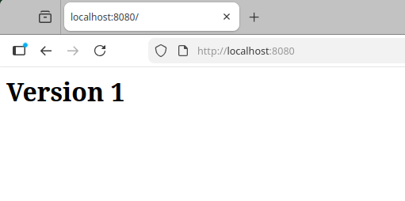

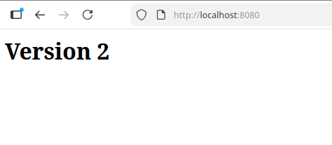

### Volumen nombrado (datos persistentes)

```bash
sudo docker volume create datos_persistentes
sudo docker run -d --name prueba_volumen -v datos_persistentes:/datos nginx:alpine
sudo docker volume ls
sudo docker inspect prueba_volumen
```

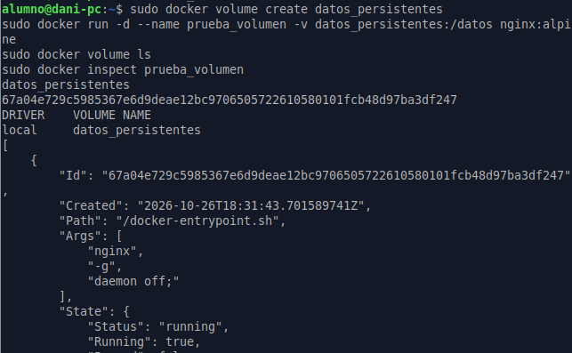

### Diferencias entre bind mount y volumen nombrado

Un **bind mount** vincula una carpeta concreta del host, elegida por el usuario, con una carpeta del contenedor. Se indica escribiendo la ruta de esa carpeta, por ejemplo `-v /home/alumno/web_dev:/usr/share/nginx/html`, y se gestiona como cualquier carpeta normal del sistema. Los cambios se ven al instante en los dos lados, así que si se edita un archivo, el contenedor lo ve sin reiniciarse. Por eso se usa sobre todo en desarrollo. 

Un **volumen nombrado**, en cambio, lo crea y gestiona Docker, que lo guarda en `/var/lib/docker/volumes`. Se indica con un nombre en lugar de una ruta, por ejemplo `-v datos_persistentes:/datos`, y se administra con los comandos `docker volume` (create, ls, inspect y rm). Es independiente de las carpetas del host, lo que lo hace más portable y seguro, y por eso es la opción recomendada en producción para guardar datos que deben persistir, como los de una base de datos.

---

## Ejercicio 3: Construcción de una imagen con Dockerfile

Se crea la carpeta del proyecto y  dentro una carpeta `web` con un `index.html` personalizado

```
mi_proyecto/
├── Dockerfile
├── docker-compose.yml
└── web/
    └── index.html
```

`Dockerfile`:

```
FROM nginx:alpine
COPY web/index.html /usr/share/nginx/html/
EXPOSE 80
```

- `FROM nginx:alpine`: parte de la imagen oficial de Nginx en su versión ligera.
- `COPY`: copia el `index.html` de la carpeta `web` a la carpeta web de Nginx.
- `EXPOSE 80`: indica el puerto que usa el servidor.

Se construye la imagen y se lanza un contenedor en el puerto 8085:

```
sudo docker build -t mi_web:1.0 .
sudo docker run -d --name mi_web -p 8085:80 mi_web:1.0
```

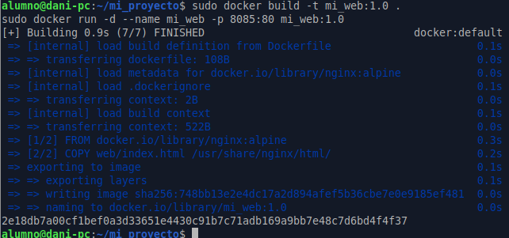

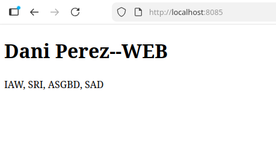

---

## Ejercicio 4: Orquestación multi-contenedor con Docker Compose

Fichero `docker-compose.yml`:

```
services:
  app:
    build: .
    ports:
      - "8080:80"
    volumes:
      - ./web:/usr/share/nginx/html
    networks:
      - red_interna

  cache:
    image: redis:alpine
    volumes:
      - datos_cache:/data
    networks:
      - red_interna

networks:
  red_interna:

volumes:
  datos_cache:
```

### Despliegue

```bash
sudo docker compose up -d
```

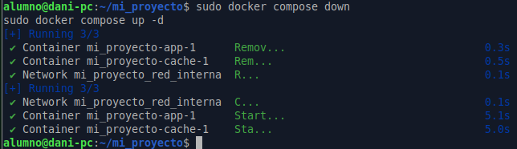

### Verificación

```bash
sudo docker compose ps
```

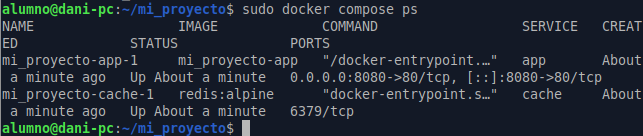

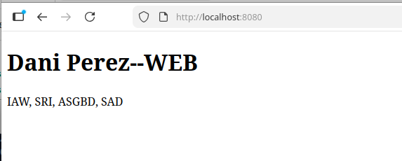

### Detener y eliminar la infraestructura

```bash
sudo docker compose down
```

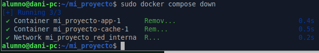

`docker compose down` detiene y elimina los contenedores y la red creados por Compose, pero conserva el volumen nombrado `datos_cache`.
